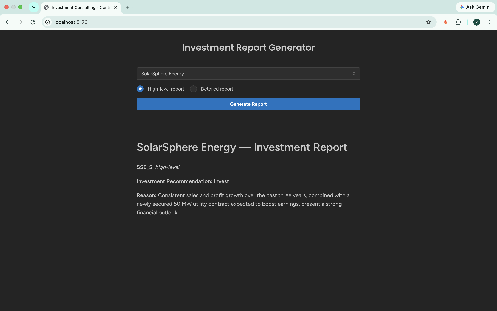
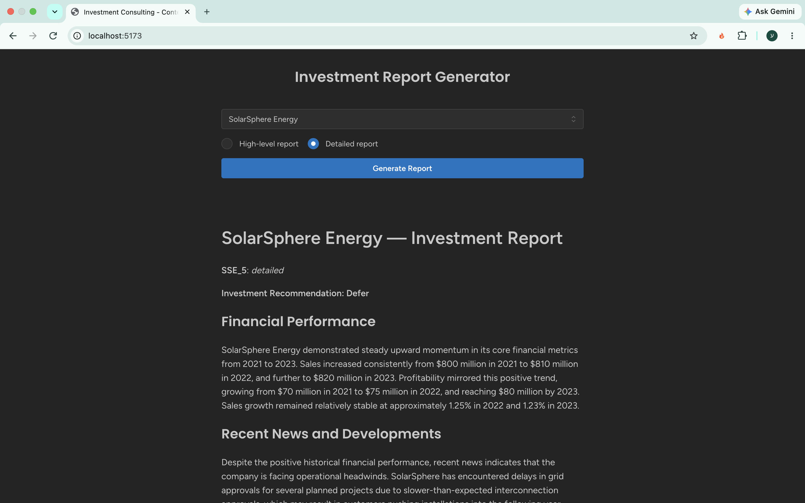

# AI-Powered Investment Report Generator

A full-stack application that generates AI-powered investment reports by combining historical financial data with recent company news.

Built with **TypeScript, Node.js, Express, PostgreSQL, Sequelize, and Google Gemini**, with a focus on LLM context engineering, backend integration, and performance optimization.

## Features

- **AI Investment Analysis:** Generates investment recommendations based on financial performance and recent developments.
- **Two Report Modes:** High-level recommendations and detailed financial reports.
- **Multiple Data Sources:** Combines PostgreSQL financial records with a news API.
- **Conflict-Aware Analysis:** Instructs the LLM to prioritize newer financial information and explain discrepancies.
- **In-Memory Caching:** Uses a Map with a 10-minute TTL to reduce repeated Gemini API requests.
- **API Reliability:** Implements request timeouts and HTTP error handling.
- **Markdown Reports:** Displays structured AI-generated reports in a web interface.

## Tech Stack

| Layer | Technologies |
|---|---|
| Frontend | React, Vite |
| Backend | Node.js, Express, TypeScript |
| Database | PostgreSQL, Sequelize ORM |
| AI | Google Gemini API |
| Caching | In-memory Map with TTL |

## Architecture

```text
React Frontend
      |
      v
Express Backend
      |
      v
In-Memory Cache
      |
      +-- Cache Hit --> Return Report
      |
      +-- Cache Miss
              |
              +--> PostgreSQL (Financial Data)
              |
              +--> News API (Recent News)
              |
              v
       Context Construction
              |
              v
          Gemini API
              |
              v
       Markdown Report
              |
              v
       Cache and Return
```

## How It Works

1. The user selects a company and report type.
2. The backend checks whether a valid cached report exists.
3. On a cache miss, the backend retrieves historical sales and profit data from PostgreSQL and recent company news from an external API.
4. The application calculates sales growth and constructs a context-rich prompt for Gemini.
5. Gemini analyzes the supplied information and returns an investment recommendation: **Invest, Don't Invest, or Defer**.
6. The generated Markdown report is cached for 10 minutes and returned to the frontend.

### High-Level Report


### Detailed Report


## Getting Started

### Prerequisites

- Node.js 20+
- npm
- PostgreSQL connection URL with access to the provided financial dataset
- Google Gemini API key

### Installation

Clone the repository:

```bash
git clone https://github.com/amitshtark/consulting-report-project.git
cd consulting-report-project
npm install
```

Create a `.env` file inside the `server` directory:

```env
DATABASE_URL=your_postgresql_connection_url
GEMINI_API_KEY=your_gemini_api_key
```

Start the application from the project root:

```bash
npm run dev
```

Open http://localhost:5173 in your browser.

The frontend runs on port 5173 and the backend on port 3000.

## Example Report

**Company:** ByteBites Foods  
**Report Type:** High-level

**Investment Recommendation: Don't Invest**

**Reason:** Declining revenue, deteriorating profitability, and recent product safety concerns introduce significant financial and operational risks.

*Example based on a generated test report. Outputs vary with the supplied news and financial context.*

## Technical Decisions

**Context Engineering:** Financial records, calculated growth metrics, and recent news are combined into a structured prompt to guide Gemini's analysis.

**Caching:** An in-memory Map reduces redundant API calls. Entries expire after 10 minutes and are cleared when the backend process restarts.

**Reliability:** Configurable request timeouts protect the application from excessively slow external API responses.

**Data Integrity:** The model is instructed not to invent financial figures and to identify conflicts between historical records and newer information.

## Project Origin and Contributions

This project is based on the starter repository by [JonaCodes](https://github.com/JonaCodes/consulting-report-project), which provided the application scaffold, frontend, database model, and external data sources.

My implementation focuses on the backend report-generation workflow, including:

- PostgreSQL data retrieval through Sequelize
- Integration with the external news API
- Financial growth calculations
- Gemini API integration and prompt engineering
- Investment recommendation formatting
- In-memory caching with TTL
- Request timeout and error handling

## Limitations

- The cache is process-local and is not shared across multiple backend instances.
- Cached reports may not reflect newly available news until their TTL expires.
- AI-generated financial analysis can contain inaccuracies and should not be treated as professional investment advice.

## Future Improvements

- Article-aware cache keys
- Automated tests for report generation and API failures
- Persistent or distributed caching
- Improved source attribution for generated recommendations

---

**Disclaimer:** This project is for educational and demonstration purposes only and does not provide financial advice.